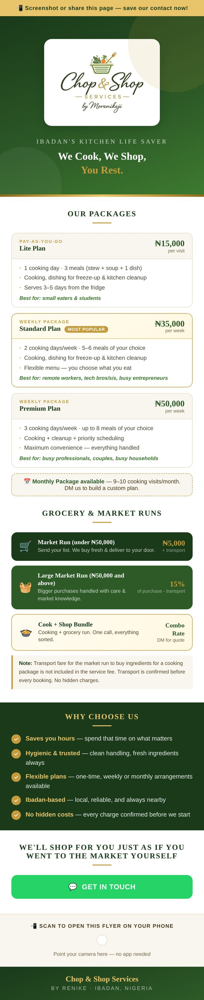

# Chop & Shop Services: Mobile Flyer Website

A one-page, mobile-first website for **Chop & Shop Services**, a home cooking and market-run business in Ibadan, Nigeria. It works as a digital flyer: customers open it from a link or QR code, read the packages and prices, and book on WhatsApp in one tap.

<p align="center">
  
</p>

## The problem

A small service business needs something between a printed flyer and a full website. It has to be cheap to run, quick to update when prices change, and easy to share in WhatsApp status updates and group chats, where most local customers find services.

## What it does

| Section | Purpose |
| --- | --- |
| Hero with logo and tagline | States the offer in one line: "We Cook, We Shop, You Rest." |
| Cooking packages | Three plans (pay-as-you-go, weekly standard, weekly premium) with price, inclusions and who each is for |
| Grocery and market runs | Fees for small and large runs, plus a bundle option, with transport costs stated openly |
| Why choose us | Five short trust points: time saved, hygiene, flexible plans, local service, no hidden costs |
| Contact button | One tap opens WhatsApp with a message already written, so the customer does not have to type |
| QR code | Generated from the page address, so the printed or shared flyer always points to the live page |

## Design decisions

- **Single page, no framework.** One `index.html` file plus a logo image. Nothing to build or install, and it loads fast on slow mobile data.
- **Designed for a phone first.** The layout is a single 430px column that also reads well on a desktop.
- **WhatsApp as the booking channel.** The button uses a `wa.me` link with a prefilled message, because that is how the customers already talk to the business.
- **Prices shown up front.** Every plan and fee is on the page, with transport costs explained in a note, which builds trust and cuts down repeat questions.
- **Brand colours carried through.** Deep green and gold match the logo and give the page a food-and-hospitality feel.
- **Accessible by default.** The page lets users zoom, the logo has descriptive alt text, decorative icons are hidden from screen readers, and external links use `rel="noopener noreferrer"`.

## Tech

- HTML and CSS in a single file
- Google Fonts (Playfair Display and Lato)
- [qrcodejs](https://github.com/davidshimjs/qrcodejs) from cdnjs for the QR code
- Hosted on Netlify (static hosting, deploys on every commit)

## Run it locally

Open `index.html` in any browser. No build step is needed.

## Repository layout

```
.
├── index.html        The flyer page (markup, styles and QR script)
├── assets/
│   ├── logo.jpg      Brand logo
│   └── preview.jpg   Screenshot used in this README
└── README.md
```

## Need something like this for your business?

I build simple, fast flyer pages and small business websites for service businesses such as caterers, salons, tutors, repair services and event vendors. A typical page includes your branding, prices or packages, a WhatsApp booking button, a shareable link and a QR code.

To discuss a page for your business, message me on WhatsApp using the button at the bottom of the live flyer, or contact me through my GitHub profile.

## About the author

Built and maintained by **Morenikeji Bankole**, project manager and operations professional based in Nigeria. Also see my project management work in [ERP-PROJECT](https://github.com/SmartDesk-stud/ERP-PROJECT).

## Rights

The Chop & Shop Services name, logo and content belong to their owner. The page structure is shared here as a portfolio example. Please ask before reusing the branding or copy.
